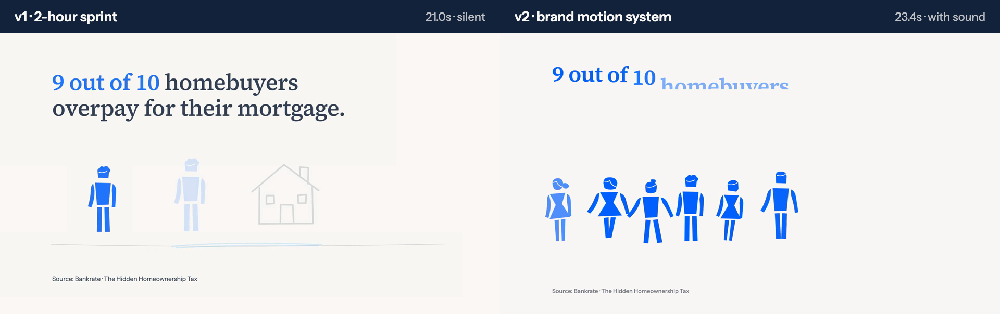
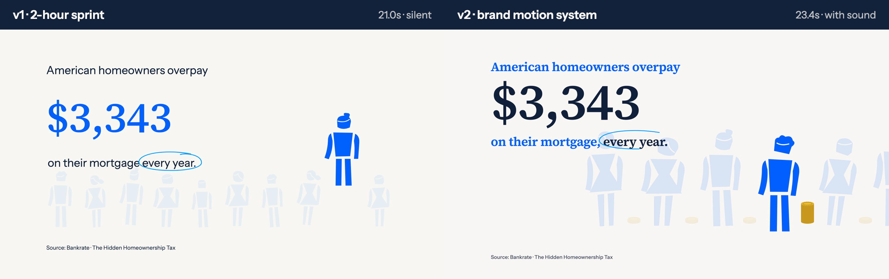
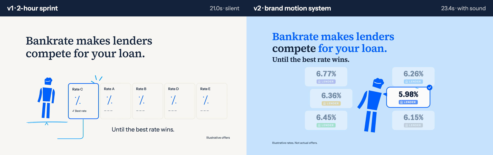
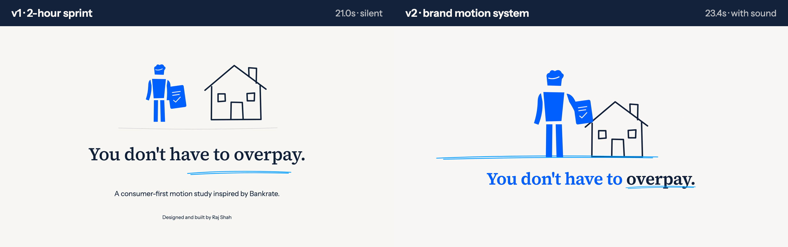

# v1 → v2: four before/after pairs

v1 is archived in `archive/v1/`. Stills come from the shipped v1 render and the v2 master (`scripts/build-compare.mjs`). The full side-by-side is in [`v1-vs-v2-side-by-side.mp4`](v1-vs-v2-side-by-side.mp4).

## 1. The continuity cut (beat 1 → 2)

v1 crossfaded two whole scenes, so for half a second the old and new hero hung on screen together as ghosts. In v2 the hero never leaves. The camera pulls back, the wall and house slide out, and nine more people hop in around the same figure, who becomes #4 of ten. _Principle: continuity. One persistent character on one layer, and the camera does the cutting._

## 2. The $3,343 moment

In v1 the number simply faded in beside a calm figure. In v2 it counts up and decelerates into its final digits, which sit in fixed-width cells so nothing jitters. As it counts, coins stream out of the hero onto a growing stack, and the hero sinks a little with each one. A quick loop circles "every year." _Principle: show, don't tell. The cost is something the body carries, not a caption._

## 3. The competition and the handoff

v1 showed empty "%" cards, a single one-slot reorder, a "Best rate" label that popped on, and a flowchart arrow. In v2 the lenders snap into place around the hero and compete in three rounds that speed up (22 → 16 → 12 frames). The rates tick down like an odometer, better tiles arc toward the hero's hand, and the winner is marked in sequence: rise, outline, check, loop. The winning tile then flies to the hand and morphs into the document the hero keeps. _Principles: rhythm, sequencing (one mark at a time), and story told through motion._

## 4. The bookend ending

v1 ended on a static card that crowded the brand line together with the portfolio credit. In v2 the flood recedes into the hero and reveals the same % wall from the opening. It flattens into the blue ground line, and the hero walks home along it holding the document. The film then holds completely still for 1.5s, and the credits move to their own quiet end slate. _Principle: the bookend. The obstacles become the path, and the brand line gets the final word to itself._
